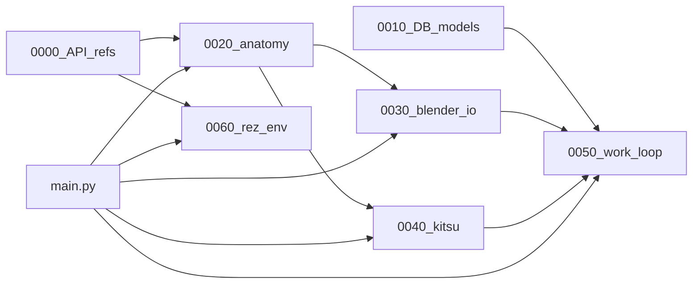
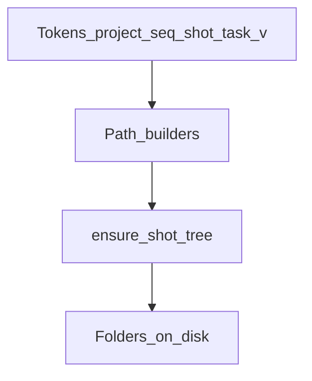
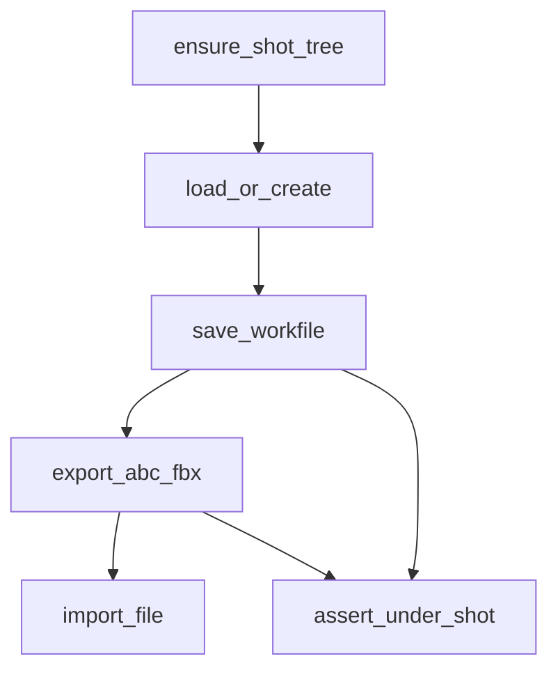
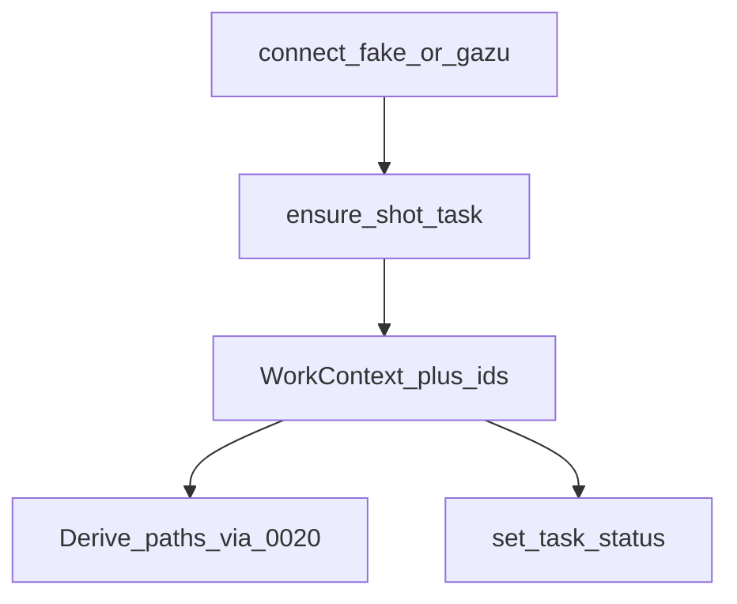
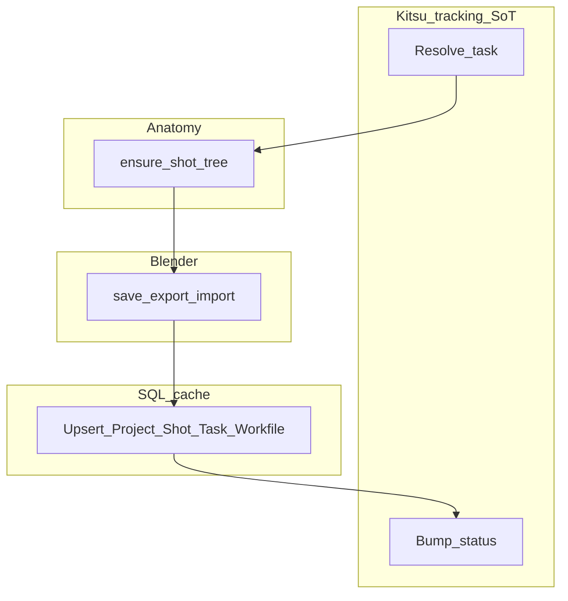
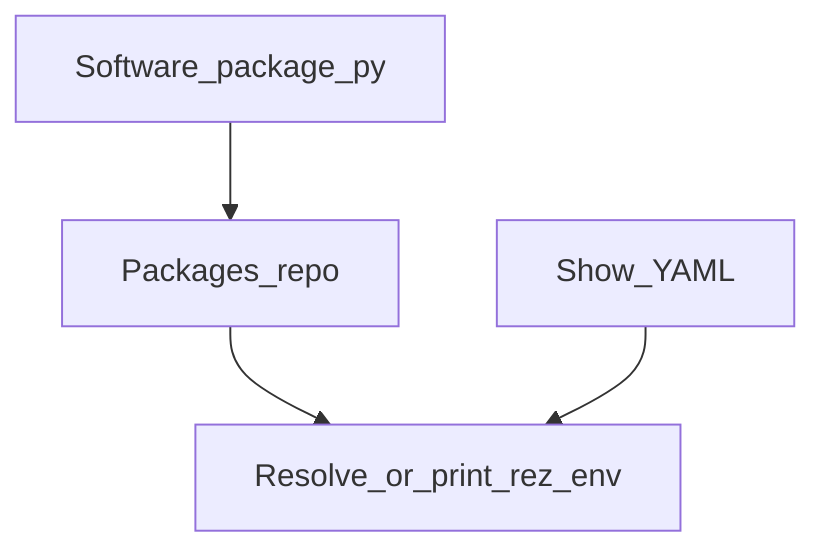

# ynput-check — Pipeline TD learning lab

Blender + Kitsu + SQLModel + **ASWF Rez** (AYON publish deferred) learned **stage by stage**: contracts and folders before DCC, tracker before glue, software envs last.

This README is the study guide: **what we built, why, and the thought process at each stage.**

---

## North star (mentor rules)

Every stage follows the same teaching loop:

1. Short **verdict / mental model**
2. **Fluxogram** (ins / outs)
3. **Contracts** (names, paths, statuses)
4. Thin **`snippet_*` code** — not a mega orchestrator
5. One or two **Pipeline TD tips**

Hard instincts we keep repeating:

| Instinct | Meaning here |
|---|---|
| Resolve by id/path | Never trust Blender selection as a pipeline address |
| Idempotent ensure | Same tokens → same folders; re-run is safe |
| Source of truth | Kitsu = tracking · disk = path contract · Blender = DCC · SQL = local cache |
| Fail loud | Missing path / bad status stops the loop |
| Config over hardcode | `STUDIO_ROOT`, optional `KITSU_*` env |

Secrets stay in env placeholders — never invent real credentials.

---

## Repo map

```text
stage_0000_code_refs/     learn each API (bpy, ayon_api, gazu, sqlmodel, rez)
stage_0010_db_models/     entity shapes (Kitsu + AYON + local)
stage_0010_db_models_output/  engine + fake seed
stage_0020_anatomy/       folder + naming contracts
stage_0030_blender_io/    load / save / import / export
stage_0040_kitsu_context/ task context + status
stage_0050_work_loop/     thin glue + SQL mirror
stage_0060_rez_env/       show → software packages (Rez product)
main.py                   root entry → pick a stage
```



---

## How we got here (decision trail)

1. **Ask:** “dummy studio pipeline connecting the stack.”
2. **Refine:** focus on **consistent folders + Blender load/save/import/export + Kitsu + DB** (AYON publish parked).
3. **Split into stages** so each lesson is runnable alone.
4. **Lock teaching:** every stage gets a briefing + fluxogram; mentor rules always win over mega-design.
5. **Cook 0020 → 0050**, then wire **`main.py`** as the root runner.
6. **Rez split:** API mind map in `0000`, show/software product in `0060`.

Thought process in one line: **anatomy before DCC before tracker before glue before software envs.**

---

## stage_0000 — learn the tools (foundation)

**Thought process:** before designing a studio, learn what each library *does*. Mind maps + `snippet_*` functions beat architecture slides.

| File | Stack piece |
|---|---|
| `node_002_blender.py` | `bpy.data` vs `bpy.context` vs `bpy.ops` |
| `node_003_ayon.py` | project → folder → product → version → representation |
| `node_004_kitsu.py` | project → seq/shot/asset → task + status |
| `node_005_sqlmodel.py` | engine vs session; table models |
| `node_006_rez.py` | ASWF Rez — `package.py`, requests, `ResolvedContext` |

**TD tip:** `bpy.context` is what the UI sees; automation should prefer `bpy.data` / explicit paths.

**Rez tip:** Rez configures PATH/env from packages on disk — not a venv that copies Blender. API lesson = `node_006_rez.py`; show/software product = `stage_0060_rez_env`.

---

## stage_0010 — entities before FKs (foundation)

**Thought process:** name things like Kitsu and AYON so sync is mapping, not redesign. Local SQL can hold studio extras (Plate, Delivery) but core production shapes stay familiar.

| Area | Models |
|---|---|
| Org | `Person`, `Assignment`, `Project` (+ `Server` enum) |
| Kitsu-shaped | `Episode`, `Sequence`, `Shot`, `Asset`, `Task`, `Comment` |
| AYON-shaped | `Product`, `Version`, `Representation`, `Workfile` |
| Local | `Plate` |

`stage_0010_db_models_output/` builds SQLite and can fake-seed a ~200-person studio.

**Fix made while wiring 0050:** `Server` lived nowhere (circular import between plate/project). It now belongs on `node_004_db_model_project.py` as a small `str` enum (`local` / `studio` / `cloud`).

**TD tip:** Python class names can be casual; **table shapes should mirror the APIs**.

---

## stage_0020 — anatomy (paths are the contract)

**Thought process:** if two artists disagree on a folder, APIs cannot save you. Lock **tokens → paths → mkdir** with zero Blender/Kitsu/SQL.

### Fluxogram



### What we built

| File | Role |
|---|---|
| `node_001_briefing.md` | lesson + fluxogram |
| `node_002_contracts.py` | frozen `WorkContext` (DUMY / SEQ010 / SH010 / modeling / v001) |
| `node_003_anatomy.py` | path helpers + idempotent `ensure_shot_tree` + escape guard |
| `node_004_run_ensure_tree.py` | create tree twice, print paths |

### On-disk template

```text
{STUDIO_ROOT}/DUMY/SEQ010/SH010/
  work/blender/DUMY_SH010_modeling_v001.blend
  export/abc/…   export/fbx/…
  import/ref/
  publish/          # reserved for later
```

**Naming:** `{projectCode}_{entityCode}_{task}[_variant]_v{###}.{ext}`

**TD tip:** `ensure_*` must be safe to call on every open/save. Re-run = no-op, not error.

---

## stage_0030 — Blender I/O

**Thought process:** Blender consumes anatomy paths; it does not invent trees. Outside Blender we still exercise the contract with **stub files** so OS Python can learn the loop.

### Fluxogram



### What we built

| File | Role |
|---|---|
| `node_001_briefing.md` | load/save vs import/export |
| `node_002_adapter_blender.py` | `snippet_load/save/export/import_*` |
| `node_003_run_io_roundtrip.py` | full roundtrip runner |

| Op | Inside Blender | Outside Blender |
|---|---|---|
| save | `wm.save_as_mainfile` | stub `.blend` bytes |
| export | alembic/fbx ops when available | stub `.abc` / `.fbx` |
| import | bpy import ops | require file exists |

**TD tip:** if a save path escapes the shot root, **fail loud** — quiet Desktop exports are how versions vanish.

---

## stage_0040 — Kitsu context

**Thought process:** the tracker owns **what work** and **status**. Paths are derived from tokens via 0020 — Kitsu is not the filesystem SoT.

### Fluxogram



### What we built

| File | Role |
|---|---|
| `node_001_briefing.md` | SoT reminder + fluxogram |
| `node_002_adapter_kitsu.py` | fake store by default; gazu when env set |
| `node_003_run_task_context.py` | resolve task, bump status, print derived paths |

**Live env (optional):**

```text
KITSU_HOST=https://YOUR_KITSU_HOST/api
KITSU_EMAIL=you@studio.com
KITSU_PASSWORD=YOUR_PASSWORD
```

Fake and live return the **same bundle shape** (`project` / `sequence` / `shot` / `task` / `context`) so later glue does not care which mode ran.

**TD tip:** status transitions are explicit. A file on disk never silently means “Done.”

---

## stage_0050 — work loop + SQL cache

**Thought process:** orchestration should be boring. Call adapters in order, log every handoff. SQLModel **mirrors** rows for audit — it must not become a second production tracker.

### End-to-end fluxogram



### What we built

| File | Role |
|---|---|
| `node_001_briefing.md` | study sheet + SoT table |
| `node_002_adapter_sql.py` | upsert into stage_0010 models → `stage_0050_work.db` |
| `node_003_run_work_loop.py` | chain 0040 → 0020 → 0030 → SQL → status |

### Loop order (read this until it sticks)

1. Kitsu: ensure shot/task → status `wip`
2. Anatomy: `ensure_shot_tree`
3. Blender: load → save → export abc/fbx → import
4. SQL: upsert Project / Shot / Task / Workfile
5. Kitsu: status `waiting_for_approval` (+ SQL status refresh)

**TD tip:** glue modules import **adapters**, not raw `gazu` / `bpy` / ORM models (SQL stays behind its adapter).

---

## stage_0060 — Rez show / software product

**Thought process:** split learning from shipping.

- **0000** = what Rez *is* (`ResolvedContext`, `package.py`, request syntax)
- **0060** = studio product: packages repo + show YAML + resolve/print

### Fluxogram



### What we built

| File | Role |
|---|---|
| `node_001_briefing.md` | product lesson + fluxogram |
| `node_002_contracts.py` | `SoftwareSpec` / `ShowEnv` |
| `node_003_packages_repo.py` | write `packages/{name}/{version}/package.py` |
| `node_004_shows.py` | `shows/DUMY.yaml` request matrix |
| `node_005_resolve.py` | Rez resolve **or** print `rez-env …` |
| `node_006_run_studio_rez.py` | `bootstrap` / `list` / `resolve` CLI |

Demo softwares (stubs): `python`, `blender`, `pipeline_core`, `show_dumy`.

**TD tip:** pin versions in show YAML for production shells; floating requests are sandbox-only. Authoring packages does **not** require Rez installed — entering the env does.

---

## `main.py` — root entry

**Thought process:** stages remain the source of truth. Root only **picks a lesson** and loads that stage’s `main()`.

```bash
uv run python main.py              # default = full loop
uv run python main.py anatomy      # 0020
uv run python main.py blender      # 0030
uv run python main.py kitsu        # 0040
uv run python main.py loop         # 0050
uv run python main.py rez          # 0060 bootstrap
uv run python main.py rez -- list
uv run python main.py rez -- resolve DUMY
uv run python main.py --list
```

Aliases: `0020`, `0030`, `0040`, `0050`, `0060`/`software`/`env`, `all`, `work`.

Optional disk root:

```bash
# PowerShell
$env:STUDIO_ROOT = "D:\shows"
uv run python main.py anatomy
```

Default studio root: `stage_0020_anatomy/_studio_root/`.

---

## Who owns what (cheat sheet)

| Concern | Owner |
|---|---|
| Task + status | **Kitsu** |
| Folder + filename shape | **Disk anatomy (0020)** |
| Load / save / import / export | **Blender (0030)** |
| Local audit rows | **SQLModel (cache)** |
| Publish products / versions / reps | **AYON — not wired yet** |
| Which softwares a show shell gets | **Rez (0060)** |

---

## What we deliberately did *not* build

- No `UnifiedPipelineOrchestrator` mega-class
- No AYON publish/resolve in 0020–0050 (still learnable in 0000)
- No deep FK redesign of stage_0010 (only the missing `Server` enum fix)
- No auto-run of demos after writing code (you drive execution)

---

## Suggested study path

1. Skim `stage_0000_code_refs/node_001_briefing.md` + one API file.
2. Skim `stage_0010_db_models/node_001_briefing.md` entity map.
3. Read each new stage’s `node_001_briefing.md` **before** its Python.
4. Run in order: `anatomy` → `blender` → `kitsu` → `loop` (or just `main.py`).
5. Re-run `anatomy` twice — feel idempotency.
6. Open `_studio_root/DUMY/...` and `stage_0050_work_loop/stage_0050_work.db` and match paths to rows.
7. Read `stage_0000_code_refs/node_006_rez.py`, then `main.py rez -- bootstrap` and inspect `_rez_root/`.

---

## Stack versions

See `pyproject.toml`: Python ≥ 3.13, `ayon-python-api`, `bpy`, `gazu`, `sqlmodel`. Managed with `uv`.

**Rez** is an ASWF system install (not a normal app dep) — see https://rez.readthedocs.io/en/stable/installation.html. stage_0060 authors packages without it; resolve upgrades to live `ResolvedContext` when Rez is importable.
