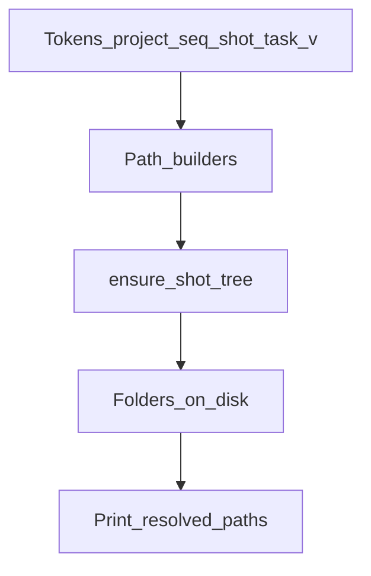

# stage_0020_anatomy — paths are the contract

## Verdict

Before Blender, Kitsu, or SQL: lock **where files live** and **how they are named**.
If two artists disagree on a folder, the pipeline is already broken — APIs cannot fix that.

## Mental model

```
tokens (project / seq / shot / task / version)
        ↓
   path builders   ← pure functions, no network
        ↓
 ensure_shot_tree  ← idempotent mkdir
        ↓
   real folders on disk under STUDIO_ROOT
```

Disk anatomy is a **path contract**. Later stages (Blender I/O, Kitsu, SQL) only *consume* these paths — they do not invent new trees.

## Fluxogram



## Ins / outs

| Direction | What |
|---|---|
| **In** | `STUDIO_ROOT` (env, optional), project/seq/shot/task/version tokens |
| **Out** | shot root + `work/`, `export/`, `import/`, `publish/` dirs; resolved file paths |
| **Not yet** | Blender load/save, Kitsu status, SQL rows, AYON publish |

## On-disk template (DUMY)

```text
{STUDIO_ROOT}/
  DUMY/
    SEQ010/
      SH010/
        work/blender/     → *.blend workfiles
        export/abc/       → alembic outs
        export/fbx/       → fbx outs
        import/ref/       → inbound refs
        publish/          → reserved for later
```

**Naming:** `{projectCode}_{entityCode}_{task}[_variant]_v{###}.{ext}`

Example: `DUMY_SH010_modeling_v001.blend`

## Pipeline TD tips

1. **Idempotent ensure** — run `ensure_shot_tree` twice; second run must be a no-op, not an error.
2. **Resolve by path tokens** — never “whatever folder is open in the file browser.” Selection/UI is UX, not a contract.
3. **Config over hardcode** — root comes from `STUDIO_ROOT`; default only for local learning.

## Source of truth (this stage)

| System | Role here |
|---|---|
| Disk anatomy | owns folder + filename shape |
| Kitsu / Blender / SQL / AYON | out of scope until later stages |

## Run (when you ask)

```bash
uv run python stage_0020_anatomy/node_004_run_ensure_tree.py
```

Re-run to feel idempotency. Inspect `_studio_root/DUMY/SEQ010/SH010/`.
