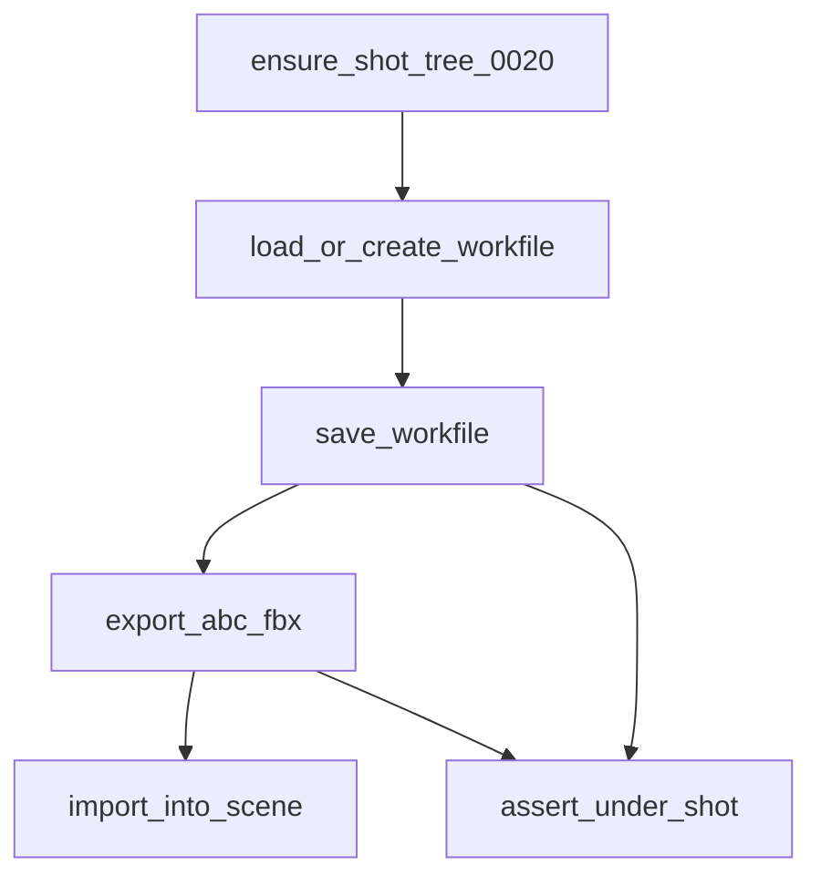

# stage_0030_blender_io — DCC ops consume anatomy paths

## Verdict

Blender does not invent folders. It **loads, saves, imports, and exports** at paths from stage_0020.
Selection in the UI is for the artist; the pipeline addresses files by **path**.

## Mental model

```
ensure_shot_tree (0020)
        ↓
 load or create workfile  →  save versioned .blend
        ↓
 export abc/fbx under export/
        ↓
 import from export (or import/ref) back into the scene
```

Outside Blender, the same functions write **stub files** at those paths so you can practice the contract without opening Blender.

## Fluxogram



## Ins / outs

| Direction | What |
|---|---|
| **In** | `WorkContext` + `STUDIO_ROOT` (via 0020) |
| **Out** | `.blend` under `work/blender/`, exports under `export/{fmt}/`, optional import side-effect |
| **Not yet** | Kitsu status, SQL rows, AYON publish |

## Ops cheat

| Op | Inside Blender | Outside Blender |
|---|---|---|
| load | `wm.open_mainfile` or new | no-op if missing |
| save | `wm.save_as_mainfile` | write stub bytes to path |
| export | bpy export ops when available | touch stub `.abc` / `.fbx` |
| import | bpy import ops when available | require file exists; log only |

## Pipeline TD tips

1. **Path over selection** — never “export selected objects to Desktop.”
2. **Fail if path escapes shot root** — quiet wrong-folder writes are how shows lose versions.
3. **Version is a token** — `v001` is pinned in the context; bump intentionally.

## Run (when you ask)

```bash
uv run python stage_0030_blender_io/node_003_run_io_roundtrip.py
```

Inside Blender Scripting, open/run the same file for real `bpy` I/O.
