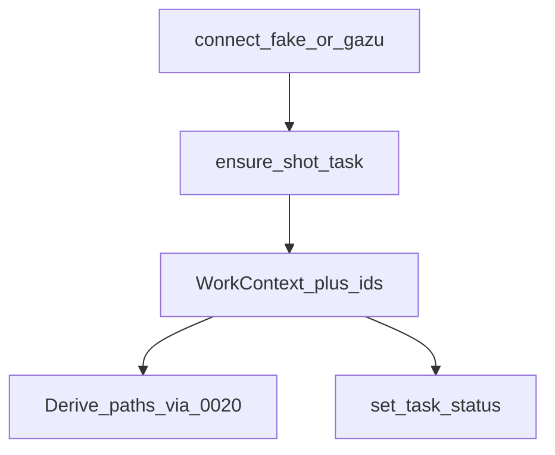

# stage_0040_kitsu_context — tracker owns work identity + status

## Verdict

Kitsu answers: **which project / shot / task am I on, and what is the status?**
Disk paths are **derived** from those tokens via stage_0020 — the tracker does not store your folder tree as SoT.

## Mental model

```
connect (fake | gazu)
        ↓
 ensure project → sequence → shot → task
        ↓
 WorkContext tokens (+ kitsu ids)
        ↓
 derive workfile path (0020 anatomy)
        ↓
 status: todo → wip → waiting_for_approval
```

## Fluxogram



## Ins / outs

| Direction | What |
|---|---|
| **In** | dummy tokens; optional `KITSU_HOST` `/api`, `KITSU_EMAIL`, `KITSU_PASSWORD` |
| **Out** | task dict with ids + status; derived anatomy paths |
| **Not yet** | Blender I/O, SQL cache, AYON |

## Source of truth

| System | Owns |
|---|---|
| **Kitsu** | task existence + status (tracking SoT) |
| **Disk anatomy** | where the workfile lives |
| SQL / AYON | later |

## Pipeline TD tips

1. **Address by id** after ensure — names are labels; ids are handoffs.
2. **Fake mode is not lying** — same return shape as live so orchestration stays identical.
3. **Status transitions are explicit** — never imply “Done” because a file exists.

## Env (live only)

```text
KITSU_HOST=https://YOUR_KITSU_HOST/api
KITSU_EMAIL=you@studio.com
KITSU_PASSWORD=YOUR_PASSWORD
```

## Run (when you ask)

```bash
uv run python stage_0040_kitsu_context/node_003_run_task_context.py
```
