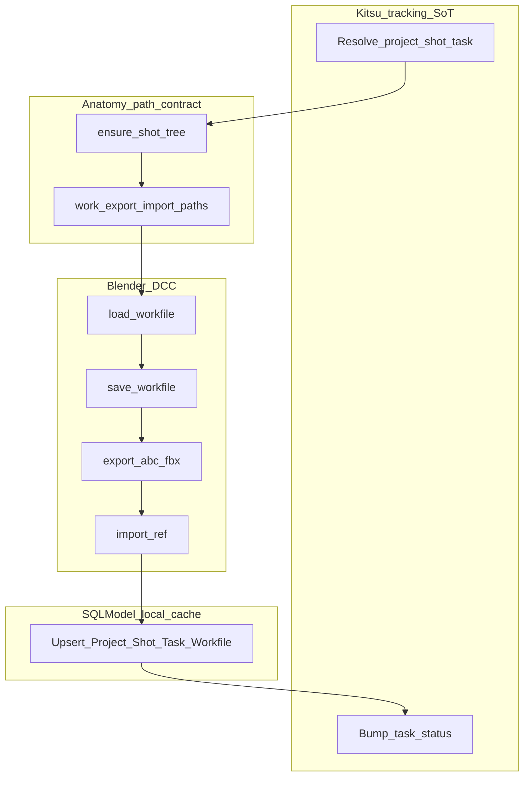

# stage_0050_work_loop — thin glue + SQL cache

## Verdict

Orchestration is boring on purpose: call adapters in order, log every handoff.
SQLModel **mirrors** Project / Shot / Task / Workfile for audit — it is **not** a second production tracker.

## Mental model

```
Kitsu context (0040)
    → ensure folders (0020)
    → Blender save/export (0030)
    → SQL upsert cache (0010 models)
    → Kitsu status bump (0040)
```

## End-to-end fluxogram



## Who owns what (study sheet)

| Concern | Owner |
|---|---|
| Task + status | Kitsu |
| Folder + filename shape | Disk anatomy (0020) |
| Load / save / import / export | Blender (0030) |
| Local audit rows | SQLModel (cache) |
| Publish products/versions | AYON — **later**, not this stage |

## Ins / outs

| Direction | What |
|---|---|
| **In** | dummy tokens; optional Kitsu env; `STUDIO_ROOT` |
| **Out** | folders + stub/real files, SQLite rows, status `todo→wip→waiting_for_approval` |
| **Trace log** | project, shot, task id, workfile path, export path, db path |

## Pipeline TD tips

1. **Thin glue** — `node_003_run_work_loop.py` imports adapters; it does not import `gazu` / `bpy` / raw SQLModel models beyond the sql adapter.
2. **Idempotent-ish** — re-run updates the same logical show; workfile row keyed by path.
3. **Fail loud** — missing export or DB error stops the loop; no silent “continue anyway.”

## Run (when you ask)

```bash
uv run python stage_0050_work_loop/node_003_run_work_loop.py
```
