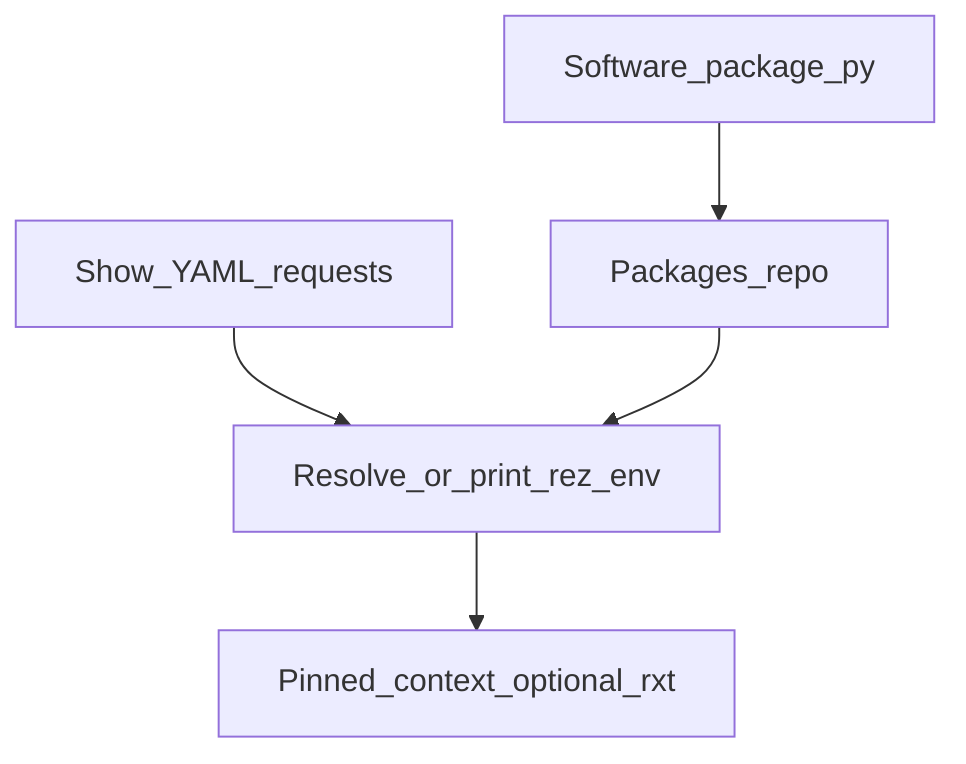

# stage_0060_rez_env — show software environments (product)

## Verdict

stage_0000 taught the Rez API. This stage **builds the studio product**: a packages repo + per-show request lists + resolve/print tooling.

Learn API → `../stage_0000_code_refs/node_006_rez.py`  
Ship product → here.

## Mental model

```
software package.py  (blender, pipeline_core, show_dumy, …)
        ↓
  packages repo under REZ_PACKAGES_PATH / _rez_root/packages
        ↓
  show YAML (DUMY → requests[])
        ↓
  resolve (ResolvedContext) OR print `rez-env …` if Rez missing
```

## Fluxogram



## Ins / outs

| Direction | What |
|---|---|
| **In** | show code (`DUMY`), software catalog definitions, optional system Rez |
| **Out** | `package.py` trees, `shows/*.yaml`, resolve report or `rez-env` command line |
| **Not** | replacing AYON/Kitsu — Rez only manages **which softwares** a show shell gets |

## Layout (created by bootstrap)

```text
stage_0060_rez_env/_rez_root/
  packages/
    blender/4.2.0/package.py
    pipeline_core/0.1.0/package.py
    show_dumy/0.1.0/package.py
  shows/
    DUMY.yaml
  contexts/          # optional saved .rxt when Rez resolves
```

## Pipeline TD tips

1. **Pin versions in show YAML** for production shells; floating `blender` is for sandbox only.
2. **Show package** (`show_dumy`) is the usual place for show-specific env (`SHOW_CODE`, roots).
3. **Idempotent bootstrap** — re-run rewrites the same trees; safe.

## Run (when you ask)

```bash
uv run python main.py rez
uv run python main.py rez -- bootstrap
uv run python main.py rez -- resolve DUMY
```
